# 04 — Screenshot index: SH comment → page → original screenshot → coverage → refinement → action → visuals

Agent S2 · 2026-11-06 · **REVIEW ONLY — nothing here is implemented.** Every annotated image carries the banner **«Proposed change — not implemented» / «تغيير مقترح — غير منفّذ»**, the SH requirement (R1–R7) and the action ID (SH-Axx) in its header strip. Originals in `screenshots/` are **never modified**: each annotated file is a copy rendered by `scratch/s2/` (HTML + IBM Plex Sans Arabic from `node_modules/@fontsource`, Chromium) with dashed outlines, numbered callouts and short Arabic/English labels; contract pages stay **blurred** as captured by R2. All figures are the **synthetic demo baseline**.

Legend of annotation colours: green dashed = add · purple dashed = change existing text/element · red hatched = remove/relabel · blue dashed = existing element (reference). Coverage classes: Fully · Partially · Missing · Unverifiable.

## 1. Visual index by action (every action in Part A and Part B that proposes a UI change)

| Action | Req | Proposal | Original screenshot(s) (unchanged) | Annotated placement | Detail crop (2×) | Wireframe / current-vs-proposed | Thumbnail |
|---|---|---|---|---|---|---|---|
| **SH-A01** | R2 R5 | Dashboard aging card: standing-balance chip + carry-over line | [01b-insights-dashboard-full-ar.jpg](screenshots/01b-insights-dashboard-full-ar.jpg) [120-dashboard-charts-toolbar-v2-ar.jpg](screenshots/120-dashboard-charts-toolbar-v2-ar.jpg) [100b-insights-dashboard-full-en.jpg](screenshots/100b-insights-dashboard-full-en.jpg) | [AR](annotated/SH-A01-aging-standing-balance-ar.jpg) [EN](annotated/SH-A01-aging-standing-balance-en.jpg) | [detail 1](annotated/SH-A01-detail-1.jpg) | — | <a href="annotated/SH-A01-aging-standing-balance-ar.jpg">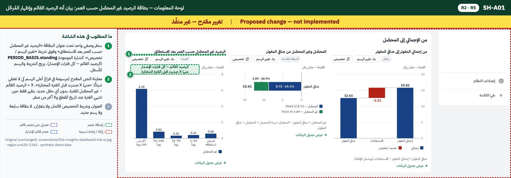</a> |
| **SH-A02** | R2 R4 | One aging scheme (7 outputs), basis caption, drill from bars | [01b-insights-dashboard-full-ar.jpg](screenshots/01b-insights-dashboard-full-ar.jpg) [61b-smart-receivables-report-full-ar.jpg](screenshots/61b-smart-receivables-report-full-ar.jpg) [134-analysis-tab-reasons-concentration-ar-v2.jpg](screenshots/134-analysis-tab-reasons-concentration-ar-v2.jpg) | [dashboard](annotated/SH-A02-aging-scheme-dashboard-ar.jpg) [Smart Reports](annotated/SH-A02-aging-scheme-smart-report-ar.jpg) [NC analysis](annotated/SH-A02-aging-scheme-nc-analysis-ar.jpg) | — | — | <a href="annotated/SH-A02-aging-scheme-dashboard-ar.jpg">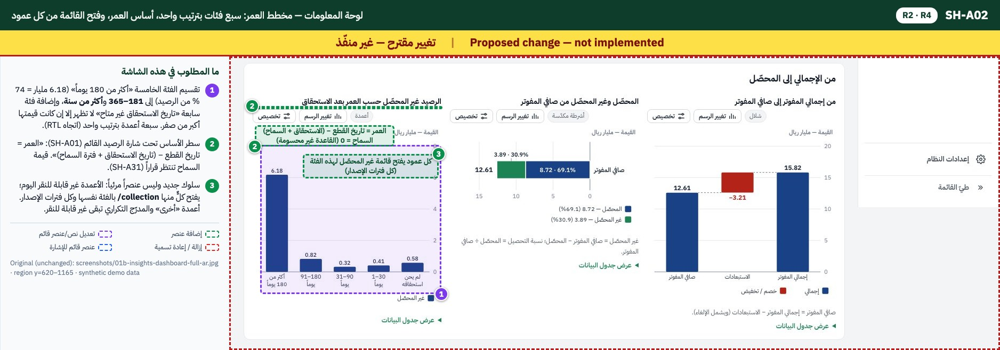</a> |
| **SH-A03** | R2 | Debtor in the uncollected list, details row and CSV; rename the issuer line | [14-uncollected-list-rows-ar-v2.jpg](screenshots/14-uncollected-list-rows-ar-v2.jpg) [16-uncollected-row-expanded-ar.jpg](screenshots/16-uncollected-row-expanded-ar.jpg) | [list](annotated/SH-A03-debtor-in-uncollected-list-ar.jpg) [details row](annotated/SH-A03-debtor-in-expanded-row-ar.jpg) | [detail 1](annotated/SH-A03-detail-1.jpg) | [A03-wireframe](wireframes/SH-A03-wireframe-ar.jpg) [A03-current-vs-proposed](wireframes/SH-A03-current-vs-proposed.jpg) | <a href="annotated/SH-A03-debtor-in-uncollected-list-ar.jpg">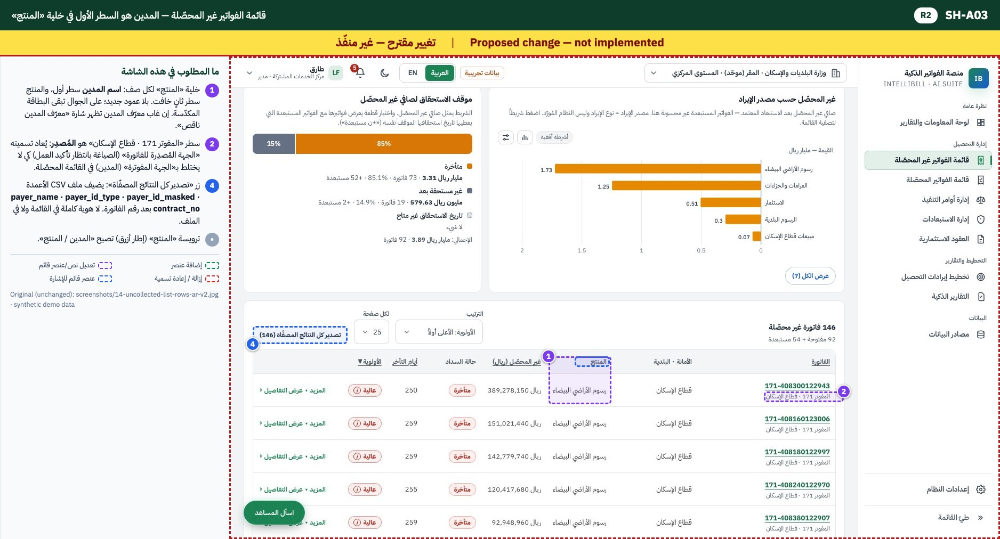</a> |
| **SH-A04** | R2 R4 R5 | Decision Room link must open what the item counts (31) | [32b-decision-item-analysis-full-ar.jpg](screenshots/32b-decision-item-analysis-full-ar.jpg) [36-drill-housing-overdue-all-periods-stock-ar-v2.jpg](screenshots/36-drill-housing-overdue-all-periods-stock-ar-v2.jpg) | [link](annotated/SH-A04-decision-link-population-ar.jpg) [landing list](annotated/SH-A04-decision-link-landing-list-ar.jpg) | — | — | <a href="annotated/SH-A04-decision-link-population-ar.jpg">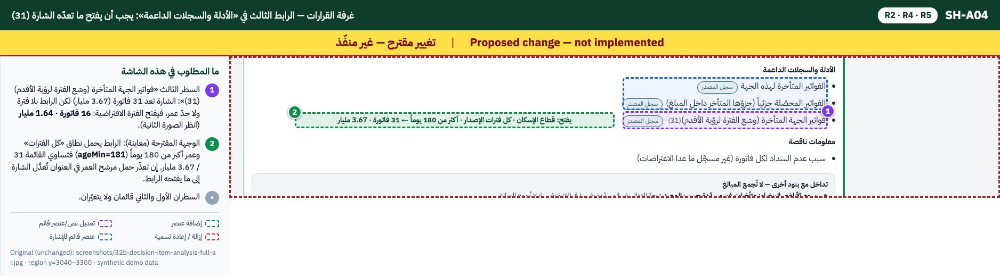</a> |
| **SH-A05** | R5 R3 | Journey: dashboard→Planning link, sidebar Decision Room, focus line→item | [01b-insights-dashboard-full-ar.jpg](screenshots/01b-insights-dashboard-full-ar.jpg) [30-decision-room-top-ar.jpg](screenshots/30-decision-room-top-ar.jpg) [20b-planning-landing-full-ar.jpg](screenshots/20b-planning-landing-full-ar.jpg) | [(a) dashboard link row](annotated/SH-A05-journey-dashboard-to-planning-ar.jpg) [(b) sidebar](annotated/SH-A05-journey-sidebar-decision-room-ar.jpg) [(c) focus lines](annotated/SH-A05-journey-focus-to-item-ar.jpg) | — | — | <a href="annotated/SH-A05-journey-dashboard-to-planning-ar.jpg">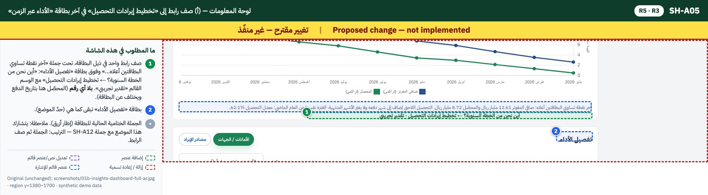</a> |
| **SH-A06** | R3 R6 | Planning: method-and-assumptions panel, expected-remaining tile, aged share | [20b-planning-landing-full-ar.jpg](screenshots/20b-planning-landing-full-ar.jpg) [24-planning-probability-wording-ar.jpg](screenshots/24-planning-probability-wording-ar.jpg) [102-planning-forecast-en.jpg](screenshots/102-planning-forecast-en.jpg) | [AR](annotated/SH-A06-planning-method-panel-ar.jpg) [EN](annotated/SH-A06-planning-method-panel-en.jpg) | [detail 1](annotated/SH-A06-detail-1.jpg) [detail 2](annotated/SH-A06-detail-2.jpg) | [A06-wireframe](wireframes/SH-A06-wireframe-ar.jpg) [A06-current-vs-proposed](wireframes/SH-A06-current-vs-proposed.jpg) | <a href="annotated/SH-A06-planning-method-panel-ar.jpg">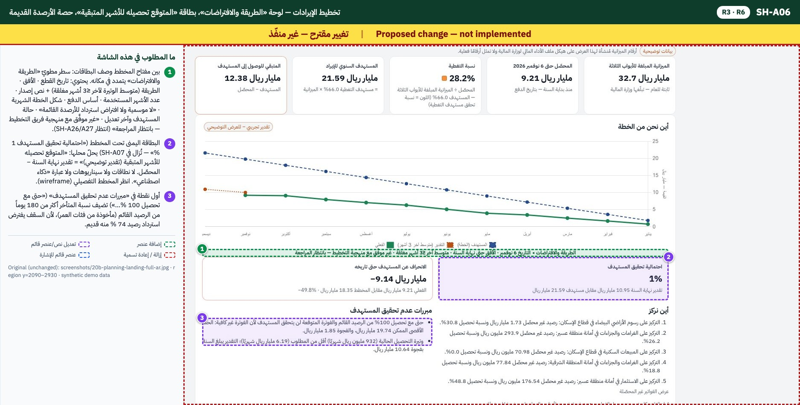</a> |
| **SH-A07** | R3 R4 R6 | Planning: remove «probability of reaching the target» tile | [24-planning-probability-wording-ar.jpg](screenshots/24-planning-probability-wording-ar.jpg) | [AR](annotated/SH-A07-planning-remove-probability-tile-ar.jpg) | [detail 1](annotated/SH-A07-detail-1.jpg) | [A07-wireframe](wireframes/SH-A07-wireframe-ar.jpg) [A07-current-vs-proposed](wireframes/SH-A07-current-vs-proposed.jpg) | <a href="annotated/SH-A07-planning-remove-probability-tile-ar.jpg">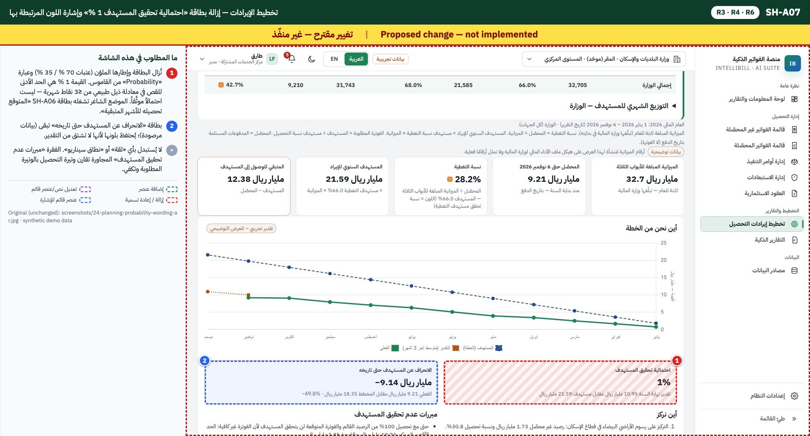</a> |
| **SH-A08** | R3 R6 | One target source, one monthly shape, honest status wording | [24-planning-probability-wording-ar.jpg](screenshots/24-planning-probability-wording-ar.jpg) [104-chat-forecast-prioritisation-en.jpg](screenshots/104-chat-forecast-prioritisation-en.jpg) | [tile AR](annotated/SH-A08-one-target-honest-status-ar.jpg) [chat EN](annotated/SH-A08-one-target-chat-answer-en.jpg) | — | — | <a href="annotated/SH-A08-one-target-honest-status-ar.jpg">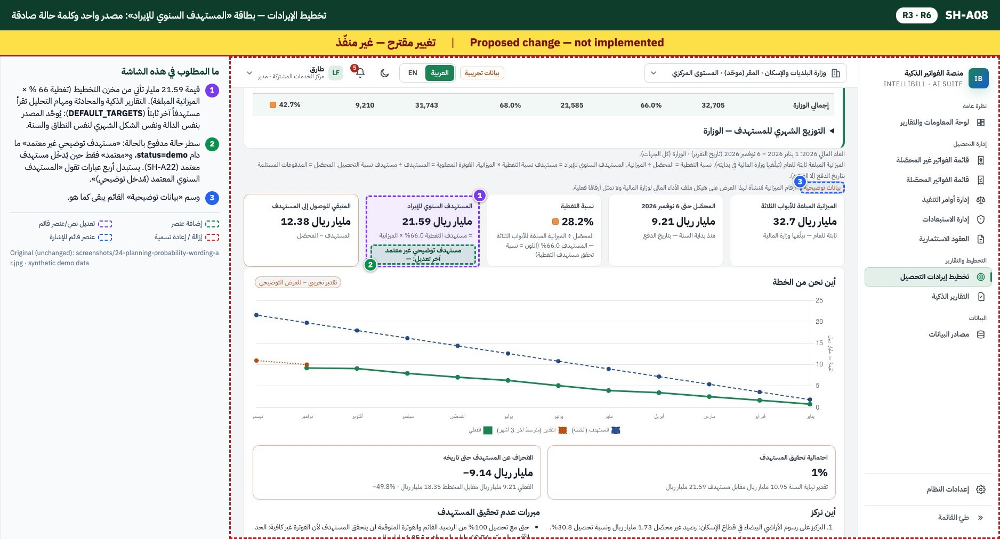</a> |
| **SH-A09** | R3 R4 R5 | Smart Reports chat: honest answer + links for forecast/probability/priority | [62-chat-forecast-question-ar.jpg](screenshots/62-chat-forecast-question-ar.jpg) [63-chat-prioritization-question-ar.jpg](screenshots/63-chat-prioritization-question-ar.jpg) [64-chat-probability-question-ar.jpg](screenshots/64-chat-probability-question-ar.jpg) [104-chat-forecast-prioritisation-en.jpg](screenshots/104-chat-forecast-prioritisation-en.jpg) | [forecast AR](annotated/SH-A09-chat-forecast-answer-ar.jpg) [priority AR](annotated/SH-A09-chat-prioritisation-answer-ar.jpg) [probability AR](annotated/SH-A09-chat-probability-answer-ar.jpg) [forecast EN](annotated/SH-A09-chat-forecast-answer-en.jpg) | — | — | <a href="annotated/SH-A09-chat-forecast-answer-ar.jpg">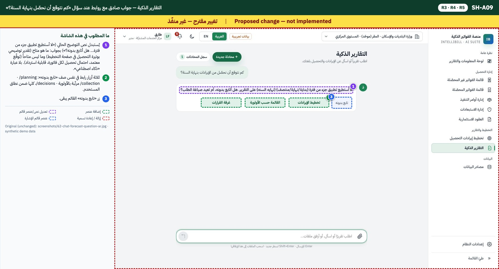</a> |
| **SH-A10** | R5 R4 R2 | Metrics dictionary: six missing definitions | [70-metrics-dictionary-ar.jpg](screenshots/70-metrics-dictionary-ar.jpg) | [AR](annotated/SH-A10-metrics-dictionary-new-group-ar.jpg) | — | — | <a href="annotated/SH-A10-metrics-dictionary-new-group-ar.jpg">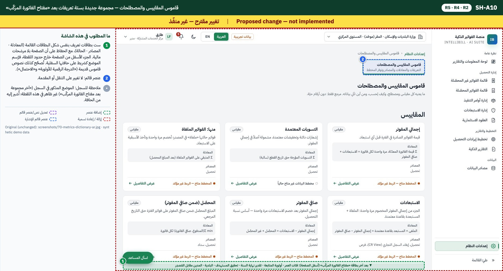</a> |
| **SH-A11** | R4 R5 R1 | One priority language: limits sentence, no owner/deadline, invoice card | [15-uncollected-priority-badge-popover-ar.jpg](screenshots/15-uncollected-priority-badge-popover-ar.jpg) [134-analysis-tab-priorities-invoices-ar-v2.jpg](screenshots/134-analysis-tab-priorities-invoices-ar-v2.jpg) [07-invoice-detail-top-ar.jpg](screenshots/07-invoice-detail-top-ar.jpg) [31-decision-item-why-expanded-ar.jpg](screenshots/31-decision-item-why-expanded-ar.jpg) | [popover](annotated/SH-A11-priority-limits-list-popover-ar.jpg) [NC priorities](annotated/SH-A11-priority-nc-owner-deadline-ar.jpg) [invoice page](annotated/SH-A11-priority-invoice-page-card-ar.jpg) [Decision Room](annotated/SH-A11-priority-decision-why-ar.jpg) | — | — | <a href="annotated/SH-A11-priority-limits-list-popover-ar.jpg">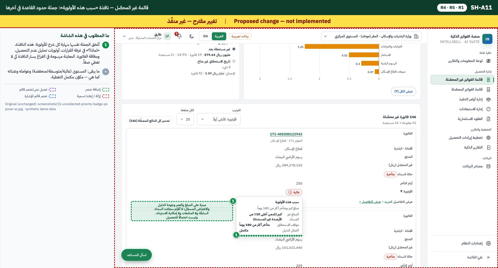</a> |
| **SH-A12** | R5 | One insight sentence under the default dashboard charts | [01b-insights-dashboard-full-ar.jpg](screenshots/01b-insights-dashboard-full-ar.jpg) | [flow charts](annotated/SH-A12-insight-sentence-flow-charts-ar.jpg) [trend](annotated/SH-A12-insight-sentence-trend-ar.jpg) | — | — | <a href="annotated/SH-A12-insight-sentence-flow-charts-ar.jpg">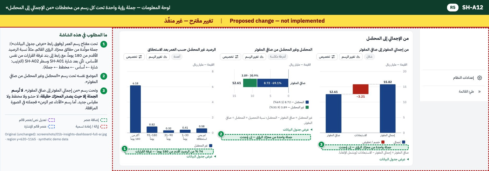</a> |
| **SH-A13** | R5 | Restricted user: Planning scope label | [92-restricted-riyadh-planning-ar.jpg](screenshots/92-restricted-riyadh-planning-ar.jpg) | [AR](annotated/SH-A13-restricted-planning-scope-label-ar.jpg) | — | — | <a href="annotated/SH-A13-restricted-planning-scope-label-ar.jpg">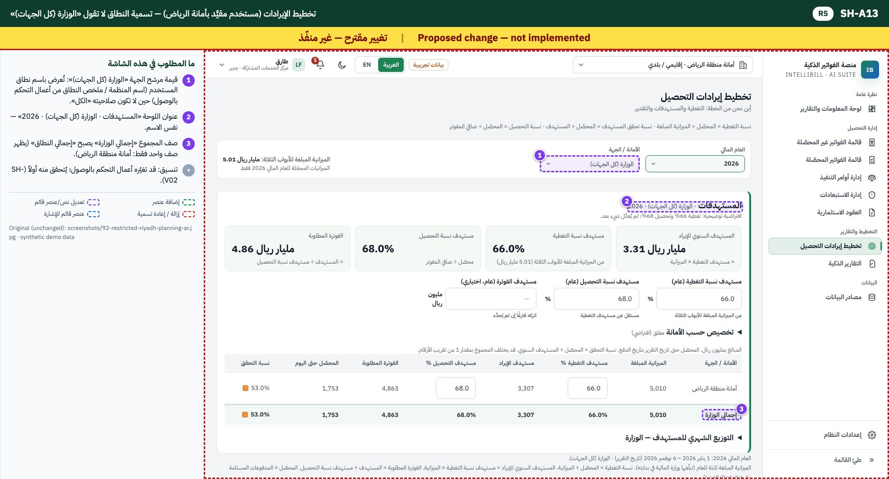</a> |
| **SH-A14** | R2 R5 | Collected-rate tooltip: name the cause of the register difference | [153-collected-rate-card-tooltip-investment-mismatch-ar-v2.jpg](screenshots/153-collected-rate-card-tooltip-investment-mismatch-ar-v2.jpg) | [AR](annotated/SH-A14-collected-rate-tooltip-cause-ar.jpg) | [detail 1](annotated/SH-A14-detail-1.jpg) | — | <a href="annotated/SH-A14-collected-rate-tooltip-cause-ar.jpg">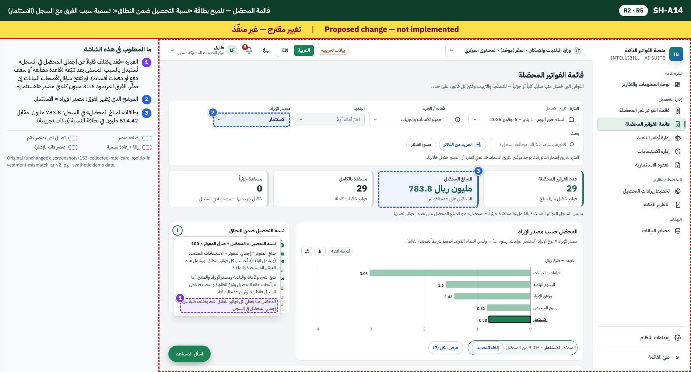</a> |
| **SH-A15** | R5 | Enforcement home: ingestion label is a method, not a source | [50-enforcement-home-ar.jpg](screenshots/50-enforcement-home-ar.jpg) | [AR](annotated/SH-A15-enforcement-ingestion-label-ar.jpg) | [detail 1](annotated/SH-A15-detail-1.jpg) | — | <a href="annotated/SH-A15-enforcement-ingestion-label-ar.jpg">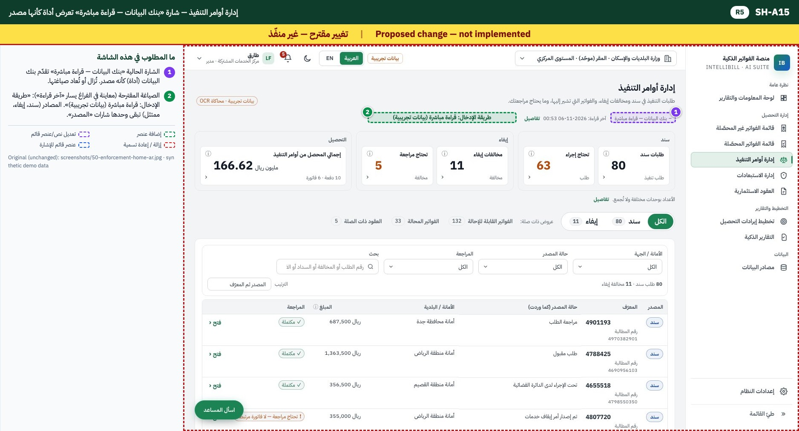</a> |
| **SH-A16** | R5 | Chart-selection rules and «recommended chart type» wording | [121-dashboard-aging-chart-picker-open-v2-ar.jpg](screenshots/121-dashboard-aging-chart-picker-open-v2-ar.jpg) [133-analysis-waterfall-picker-options-ar-v2.jpg](screenshots/133-analysis-waterfall-picker-options-ar-v2.jpg) | [picker](annotated/SH-A16-chart-picker-rules-ar.jpg) [reason format](annotated/SH-A16-chart-picker-reason-format-ar.jpg) | — | — | <a href="annotated/SH-A16-chart-picker-rules-ar.jpg">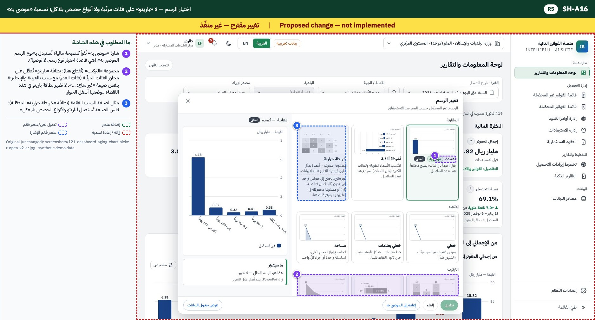</a> |
| **SH-A17** | R5 R7 | Export dialog: placeholder-picture warning line | [174-smart-export-dialog-chart-block-expanded-ar-v2.jpg](screenshots/174-smart-export-dialog-chart-block-expanded-ar-v2.jpg) | [AR](annotated/SH-A17-export-placeholder-warning-ar.jpg) | [detail 1](annotated/SH-A17-detail-1.jpg) | — | <a href="annotated/SH-A17-export-placeholder-warning-ar.jpg">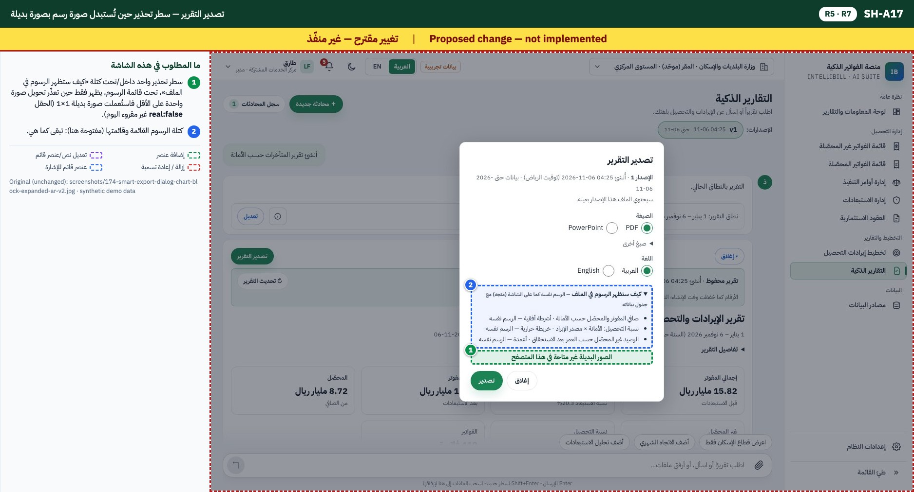</a> |
| **SH-A19** | R2 R5 | Dashboard gross card link text / destination | [01-insights-dashboard-top-ar-v2.jpg](screenshots/01-insights-dashboard-top-ar-v2.jpg) [02-drill-gross-detail-link-ar.jpg](screenshots/02-drill-gross-detail-link-ar.jpg) | [link](annotated/SH-A19-gross-card-link-ar.jpg) [destination](annotated/SH-A19-gross-card-link-destination-ar.jpg) | — | — | <a href="annotated/SH-A19-gross-card-link-ar.jpg">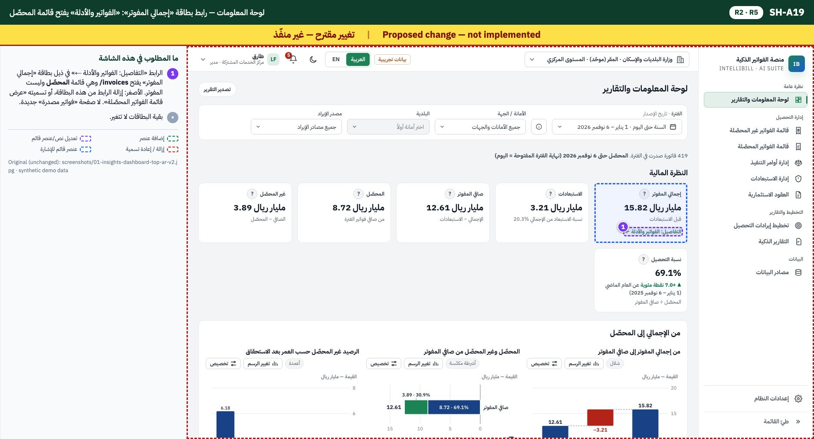</a> |
| **SH-A20** | R3 R6 | One forecast method per scope — method line (blocked) | [20b-planning-landing-full-ar.jpg](screenshots/20b-planning-landing-full-ar.jpg) | [AR](annotated/SH-A20-one-forecast-method-line-ar.jpg) | — | — | <a href="annotated/SH-A20-one-forecast-method-line-ar.jpg">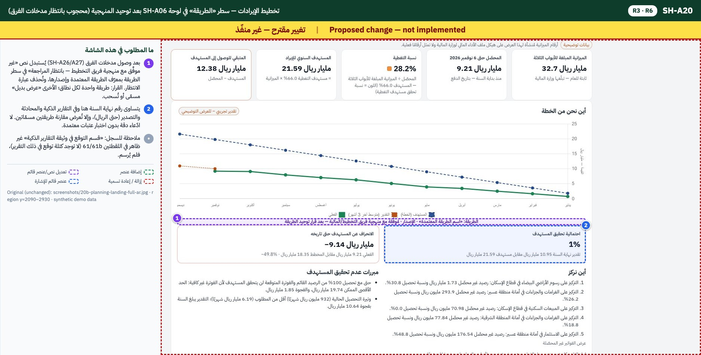</a> |
| **SH-A21** | R3 R6 | Recovery/seasonality/drivers/scenario rows in the panel (blocked) | [20b-planning-landing-full-ar.jpg](screenshots/20b-planning-landing-full-ar.jpg) | [AR](annotated/SH-A21-assumption-rows-in-panel-ar.jpg) | — | — | <a href="annotated/SH-A21-assumption-rows-in-panel-ar.jpg">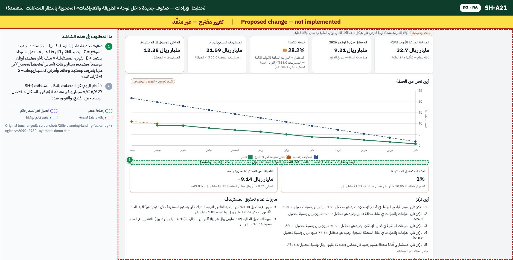</a> |
| **SH-A22** | R3 R5 R6 | Approved targets and their status (blocked) | [20-planning-landing-ar.jpg](screenshots/20-planning-landing-ar.jpg) | [AR](annotated/SH-A22-approved-targets-status-ar.jpg) | — | — | <a href="annotated/SH-A22-approved-targets-status-ar.jpg">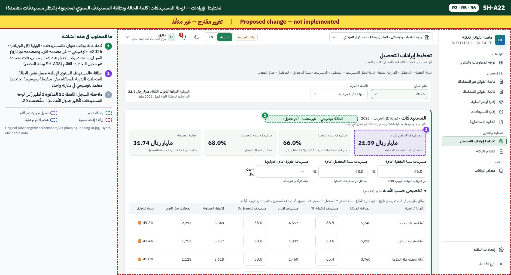</a> |
| **SH-A23** | R2 | Debtor-level view (fifth concentration card, blocked) | [134-analysis-tab-reasons-concentration-ar-v2.jpg](screenshots/134-analysis-tab-reasons-concentration-ar-v2.jpg) | [AR](annotated/SH-A23-debtor-concentration-view-ar.jpg) | — | [A23-wireframe](wireframes/SH-A23-wireframe-ar.jpg) [A23-current-vs-proposed](wireframes/SH-A23-current-vs-proposed.jpg) | <a href="annotated/SH-A23-debtor-concentration-view-ar.jpg">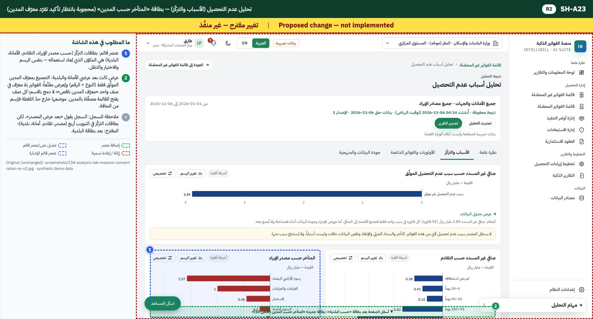</a> |
| **SH-A25** | R2 | Installment→invoice link column (blocked; page blurred) | [43-contract-invoices-refs-blurred-ar.jpg](screenshots/43-contract-invoices-refs-blurred-ar.jpg) | [AR](annotated/SH-A25-installment-invoice-link-column-ar.jpg) | — | — | <a href="annotated/SH-A25-installment-invoice-link-column-ar.jpg">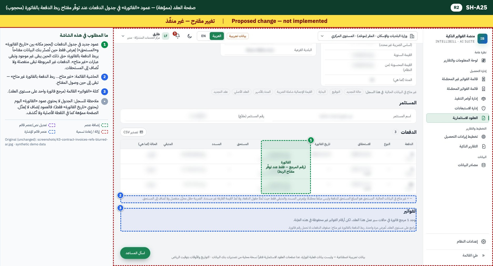</a> |

**Counts:** 41 annotated placements (37 Arabic + 4 English: A01, A06, A08, A09) · 8 detail crops · 4 wireframes + 4 current-vs-proposed images (A03, A06, A07, A23). A22's visual is the annotated Planning landing; it needs no wireframe (flag `no`).

**Actions with no drawable UI change (listed so none is silently missing):**

| Action | Why there is no image |
|---|---|
| SH-A18 retired terms as input aliases | Input handling only; **«no visual change»** in the register. Evidence screenshot for the behaviour: `screenshots/171-smart-chat-request-show-as-columns-ar-v2.jpg` (unchanged). |
| SH-A24 collection probability / recoverability | Register: **«No development now»** — a decision record. The honest «not available» statements are the existing priority popover (`screenshots/15-uncollected-priority-badge-popover-ar.jpg`) and chat reply (`screenshots/64-chat-probability-question-ar.jpg`), refined by SH-A11 / SH-A09 (their annotated images). |
| SH-A26 … A34 (Part C) | Business / coordination actions, no screen — see §4. |
| SH-V01 … V03 (verification after access control) | Verification, not a change — evidence screenshots 90–93 (unchanged, §3). |

## 2. SH comment → page → original screenshot → coverage → proposed refinement → action → visual

Row ids (R1.1 …) are those of `02-coverage-matrix.md`. «Visual» links go to the annotated placement; rows marked «unchanged screenshot» use the original capture as demonstration evidence (**no development action**).

| SH comment | Existing page / section | Original screenshot | Coverage | Proposed refinement | Action ID | Annotated / wireframe |
|---|---|---|---|---|---|---|
| R1.1 business problem before features | opening slides (no screen) | — | Fully | retain; storyline in 06 | no development action — demo evidence only | no screen — slides |
| R1.2 evidenced scale (figures) | opening slides; the figures themselves reproduce on /insights | [01b-insights-dashboard-full-ar.jpg](screenshots/01b-insights-dashboard-full-ar.jpg) | Missing (slides) | one evidence slide with labelled synthetic baseline (06); SH-A32 for real baselines | SH-A30(a), A32 (C) | no screen — slides (demo evidence: unchanged 01b) |
| R1.3 decisions that are difficult today | opening slides | — | Partially | tie to the decisions the demo supports (06) | SH-A30(a) | no screen — slides |
| R1.4 how IIM supports them | slides 9/12; platform wording of priority | [15-uncollected-priority-badge-popover-ar.jpg](screenshots/15-uncollected-priority-badge-popover-ar.jpg) | Partially | remove the «probability of every invoice» claim; state the rule-based priority limits | SH-A11, A30(a) | [SH-A11](annotated/SH-A11-priority-limits-list-popover-ar.jpg) |
| R1.5 how outcomes are measured | opening slides (KPI table) | — | Partially | five measures with four labels (06) | SH-A30(a), A32 | no screen — slides |
| R1.6 editable deck updated | — | — | Unverifiable | dependency D-6 | SH-A30(a) | no screen — coordination |
| R2.1 total outstanding | /insights tile «غير المحصّل» vs aging chart | [01b-insights-dashboard-full-ar.jpg](screenshots/01b-insights-dashboard-full-ar.jpg) | Partially | standing-balance chip + carry-over line | SH-A01 | [A01/AR](annotated/SH-A01-aging-standing-balance-ar.jpg) · [A01/EN](annotated/SH-A01-aging-standing-balance-en.jpg) |
| R2.2 overdue / not yet due | /collection due-position bar; dashboard aging | [14-uncollected-list-rows-ar-v2.jpg](screenshots/14-uncollected-list-rows-ar-v2.jpg) | Partially | same label/basis; buckets as R2.13 | SH-A01, A02 | [A02/dashboard](annotated/SH-A02-aging-scheme-dashboard-ar.jpg) |
| R2.3 debtor responsible for payment | /collection uncollected list | [14-uncollected-list-rows-ar-v2.jpg](screenshots/14-uncollected-list-rows-ar-v2.jpg) | Partially | debtor first line; issuer renamed; CSV columns | SH-A03 | [A03/list](annotated/SH-A03-debtor-in-uncollected-list-ar.jpg) · [A03/details row](annotated/SH-A03-debtor-in-expanded-row-ar.jpg) · [wireframe](wireframes/SH-A03-wireframe-ar.jpg) |
| R2.4 debtor-level view | NC reasons & concentration tab | [134-analysis-tab-reasons-concentration-ar-v2.jpg](screenshots/134-analysis-tab-reasons-concentration-ar-v2.jpg) | Missing (blocked) | fifth concentration view «حسب المدين» after D-10 | SH-A23, A33 | [A23](annotated/SH-A23-debtor-concentration-view-ar.jpg) · [wireframe](wireframes/SH-A23-wireframe-ar.jpg) |
| R2.5 revenue source | list «Unpaid by revenue source», details row | [14-uncollected-list-rows-ar-v2.jpg](screenshots/14-uncollected-list-rows-ar-v2.jpg) | Fully | no development action — demo evidence only | — | unchanged screenshot |
| R2.6 invoice number / composite key | list col 1, invoice page | [07-invoice-detail-top-ar.jpg](screenshots/07-invoice-detail-top-ar.jpg) | Fully | no development action — demo evidence only | — | unchanged screenshot |
| R2.7 contract | invoice page; CSV contract_no | [16-uncollected-row-expanded-ar.jpg](screenshots/16-uncollected-row-expanded-ar.jpg) | Partially | contract no. in the details row | SH-A03 | [A03/details row](annotated/SH-A03-debtor-in-expanded-row-ar.jpg) |
| R2.8 due date; outstanding balance | details row, invoice page | [16-uncollected-row-expanded-ar.jpg](screenshots/16-uncollected-row-expanded-ar.jpg) | Fully | no development action — demo evidence only | — | unchanged screenshot |
| R2.9 payment history | invoice page «المدفوعات» | [13-invoice-detail-payment-history-ar.jpg](screenshots/13-invoice-detail-payment-history-ar.jpg) | Fully | no development action — demo evidence only | — | unchanged screenshot |
| R2.10 objections | invoice page / /exclusions | [09-invoice-detail-excluded-objection-top-ar.jpg](screenshots/09-invoice-detail-excluded-objection-top-ar.jpg) | Fully | no development action — demo evidence only | — | unchanged screenshot |
| R2.11 exclusions | /exclusions (refined 6 Nov) | [181-exclusions-reasons-table-and-chart-ar-final.jpg](screenshots/181-exclusions-reasons-table-and-chart-ar-final.jpg) | Fully | no development action — demo evidence only | — | unchanged screenshot |
| R2.12 enforcement status | invoice page; /enforcement | [51-enforcement-order-no-invoice-top-ar.jpg](screenshots/51-enforcement-order-no-invoice-top-ar.jpg) | Fully | no development action — demo evidence only | — | unchanged screenshot |
| R2.13 aging buckets (6 requested) | dashboard / Smart Reports / NC aging | [01b-insights-dashboard-full-ar.jpg](screenshots/01b-insights-dashboard-full-ar.jpg) | Partially | seven outputs, one scheme, drill from bars | SH-A02 | [A02/dashboard](annotated/SH-A02-aging-scheme-dashboard-ar.jpg) · [A02/Smart Reports](annotated/SH-A02-aging-scheme-smart-report-ar.jpg) · [A02/NC analysis](annotated/SH-A02-aging-scheme-nc-analysis-ar.jpg) |
| R2.14 visible reporting date and due-date basis | chart cards, Data-info popover | [01-insights-dashboard-top-ar-v2.jpg](screenshots/01-insights-dashboard-top-ar-v2.jpg) | Partially | basis caption (grace value PENDING) | SH-A02, A31 (C) | [A02/dashboard](annotated/SH-A02-aging-scheme-dashboard-ar.jpg) |
| R2.15 missing due dates visibly separate | NC `unavailable` bucket; list due facet | [134-analysis-tab-reasons-concentration-ar-v2.jpg](screenshots/134-analysis-tab-reasons-concentration-ar-v2.jpg) | Partially (not demonstrable: 0 undated) | `due date unavailable` bar everywhere | SH-A02 | [A02/NC analysis](annotated/SH-A02-aging-scheme-nc-analysis-ar.jpg) |
| R2.16 unidentified debtors visibly separate | NC data quality; list flag | [134-analysis-tab-priorities-invoices-ar-v2.jpg](screenshots/134-analysis-tab-priorities-invoices-ar-v2.jpg) | Partially | «معرّف المدين ناقص» chip in the list; own row in the debtor view | SH-A03, A23 | [A03/list](annotated/SH-A03-debtor-in-uncollected-list-ar.jpg) · [A23](annotated/SH-A23-debtor-concentration-view-ar.jpg) |
| R2.17 drill-through keeps filters/totals | summary → list | [03-drill-amanah-row-riyadh-ar.jpg](screenshots/03-drill-amanah-row-riyadh-ar.jpg) | Fully (one defect) | no development action — demo evidence only; the Decision Room link defect is SH-A04 | SH-A04 | [A04/link](annotated/SH-A04-decision-link-population-ar.jpg) · [A04/landing list](annotated/SH-A04-decision-link-landing-list-ar.jpg) |
| R2.18 installments without verified link kept separate | Decision Room contract items; contract pages | [43-contract-invoices-refs-blurred-ar.jpg](screenshots/43-contract-invoices-refs-blurred-ar.jpg) | Partially (blocked) | link column only when the key exists | SH-A25, A33 | [A25](annotated/SH-A25-installment-invoice-link-column-ar.jpg) |
| R2.19 Amanah → municipality hierarchy | filters everywhere | [12-filter-municipality-dropdown-riyadh-ar.jpg](screenshots/12-filter-municipality-dropdown-riyadh-ar.jpg) | Fully | no development action — demo evidence only | — | unchanged screenshot |
| R3.1 expected annual revenue | /planning tiles + chart | [24-planning-probability-wording-ar.jpg](screenshots/24-planning-probability-wording-ar.jpg) | Partially | expected-remaining tile + panel | SH-A06 | [A06/AR](annotated/SH-A06-planning-method-panel-ar.jpg) · [A06/EN](annotated/SH-A06-planning-method-panel-en.jpg) · [wireframe](wireframes/SH-A06-wireframe-ar.jpg) |
| R3.2 expected invoiced revenue | — | [23-planning-forecast-vs-target-ar.jpg](screenshots/23-planning-forecast-vs-target-ar.jpg) | Missing (blocked) | expected billing rows in the panel after inputs | SH-A21, A26/A27 | [A21](annotated/SH-A21-assumption-rows-in-panel-ar.jpg) |
| R3.3 expected cash; existing vs future without overlap | /planning ceiling sentence | [25-planning-focus-and-reasons-ar.jpg](screenshots/25-planning-focus-and-reasons-ar.jpg) | Partially | aged share on the ceiling line; rows after inputs | SH-A06, A21 | [A06/AR](annotated/SH-A06-planning-method-panel-ar.jpg) · [A21](annotated/SH-A21-assumption-rows-in-panel-ar.jpg) |
| R3.4 actual vs expected remaining | chart legend; tiles | [24-planning-probability-wording-ar.jpg](screenshots/24-planning-probability-wording-ar.jpg) | Partially | collected + expected = estimate sub-line | SH-A06 | [A06/AR](annotated/SH-A06-planning-method-panel-ar.jpg) |
| R3.5 approved targets / status | targets panel | [20-planning-landing-ar.jpg](screenshots/20-planning-landing-ar.jpg) | Partially | status word; one target source | SH-A08, A22 | [A08/tile AR](annotated/SH-A08-one-target-honest-status-ar.jpg) · [A22](annotated/SH-A22-approved-targets-status-ar.jpg) |
| R3.6 forecast gaps (deviation, reasons) | /planning deviation tile + reasons | [24-planning-probability-wording-ar.jpg](screenshots/24-planning-probability-wording-ar.jpg) | Fully | no development action — demo evidence only | — | unchanged screenshot |
| R3.7 assumptions and drivers visible | /planning (none) | [23-planning-forecast-vs-target-ar.jpg](screenshots/23-planning-forecast-vs-target-ar.jpg) | Missing on /planning | «الطريقة والافتراضات» panel; drivers after inputs | SH-A06, A21 | [A06/AR](annotated/SH-A06-planning-method-panel-ar.jpg) · [current vs proposed](wireframes/SH-A06-current-vs-proposed.jpg) |
| R3.8 date, horizon, history, method, version | /planning | [102-planning-forecast-en.jpg](screenshots/102-planning-forecast-en.jpg) | Partially | same panel (method line); one method per scope | SH-A06, A20 | [A06/EN](annotated/SH-A06-planning-method-panel-en.jpg) · [A20](annotated/SH-A20-one-forecast-method-line-ar.jpg) |
| R3.9 seasonality | — | [23-planning-forecast-vs-target-ar.jpg](screenshots/23-planning-forecast-vs-target-ar.jpg) | Missing (blocked) | approved weights in the panel | SH-A21 | [A21](annotated/SH-A21-assumption-rows-in-panel-ar.jpg) |
| R3.10 recovery assumptions | — | [23-planning-forecast-vs-target-ar.jpg](screenshots/23-planning-forecast-vs-target-ar.jpg) | Missing (blocked) | by age bucket after inputs | SH-A21 | [A21](annotated/SH-A21-assumption-rows-in-panel-ar.jpg) |
| R3.11 base/conservative/improvement scenarios | — | [23-planning-forecast-vs-target-ar.jpg](screenshots/23-planning-forecast-vs-target-ar.jpg) | Missing (blocked) | scenarios with definition + approver | SH-A21 | [A21](annotated/SH-A21-assumption-rows-in-panel-ar.jpg) |
| R3.12 limitations stated | tag + footnote | [23-planning-forecast-vs-target-ar.jpg](screenshots/23-planning-forecast-vs-target-ar.jpg) | Fully | no development action — demo evidence only | — | unchanged screenshot |
| R3.13 actions to improve collection | «أين نركز», reasons | [20b-planning-landing-full-ar.jpg](screenshots/20b-planning-landing-full-ar.jpg) | Partially | focus line → Decision Room item; chat pointer | SH-A05(c), A09 | [A05/(c) focus lines](annotated/SH-A05-journey-focus-to-item-ar.jpg) · [A09/forecast AR](annotated/SH-A09-chat-forecast-answer-ar.jpg) |
| R3.14 no validated-AI / confidence wording | tile «احتمالية…1%»; chat; reports | [24-planning-probability-wording-ar.jpg](screenshots/24-planning-probability-wording-ar.jpg) | Partially | remove the tile; honest status; honest chat | SH-A07, A08, A09 | [A07](annotated/SH-A07-planning-remove-probability-tile-ar.jpg) · [A08/tile AR](annotated/SH-A08-one-target-honest-status-ar.jpg) · [A09/forecast AR](annotated/SH-A09-chat-forecast-answer-ar.jpg) · [tile row](wireframes/SH-A07-current-vs-proposed.jpg) |
| R4.1 priority from aging and amount | /collection priority column + popover | [15-uncollected-priority-badge-popover-ar.jpg](screenshots/15-uncollected-priority-badge-popover-ar.jpg) | Fully | no development action — demo evidence only | — | unchanged screenshot |
| R4.2 payment delays | days overdue column | [14-uncollected-list-rows-ar-v2.jpg](screenshots/14-uncollected-list-rows-ar-v2.jpg) | Partially | buckets split the long tail | SH-A02 | [A02/dashboard](annotated/SH-A02-aging-scheme-dashboard-ar.jpg) |
| R4.3 collection probability | none (by design) | [64-chat-probability-question-ar.jpg](screenshots/64-chat-probability-question-ar.jpg) | Missing — not buildable now | state «not available»; prerequisites only | SH-A24, A09, A11 | [A09/probability AR](annotated/SH-A09-chat-probability-answer-ar.jpg) · [A11/popover](annotated/SH-A11-priority-limits-list-popover-ar.jpg) |
| R4.4 recoverability | «no recoverability is assessed» | [15-uncollected-priority-badge-popover-ar.jpg](screenshots/15-uncollected-priority-badge-popover-ar.jpg) | Missing by design | limits sentence at the point of use | SH-A11, A24 | [A11/popover](annotated/SH-A11-priority-limits-list-popover-ar.jpg) |
| R4.5 long-outstanding stays visible | aging chart; Decision Room aged item | [01b-insights-dashboard-full-ar.jpg](screenshots/01b-insights-dashboard-full-ar.jpg) | Fully (link defect) | no development action — demo evidence only; SH-A04 for the item link | SH-A04 | [A04/link](annotated/SH-A04-decision-link-population-ar.jpg) |
| R4.6 why / evidence / next action / limits | popover, Decision Room «لماذا؟», invoice page | [31-decision-item-why-expanded-ar.jpg](screenshots/31-decision-item-why-expanded-ar.jpg) | Partially | limits sentence; invoice-page card | SH-A11 | [A11/Decision Room](annotated/SH-A11-priority-decision-why-ar.jpg) · [A11/invoice page](annotated/SH-A11-priority-invoice-page-card-ar.jpg) |
| R4.7 age alone never implies unrecoverable | — | [35-decision-item-evidence-links-ar-v2.jpg](screenshots/35-decision-item-evidence-links-ar-v2.jpg) | Fully | no development action — demo evidence only | — | unchanged screenshot |
| R4.8 one prioritisation language | list · Decision Room · NC · Smart Reports | [134-analysis-tab-priorities-invoices-ar-v2.jpg](screenshots/134-analysis-tab-priorities-invoices-ar-v2.jpg) | Partially | drop owner/deadline text, one limits sentence | SH-A11 | [A11/NC priorities](annotated/SH-A11-priority-nc-owner-deadline-ar.jpg) |
| R5.1 where we stand / issues / expected / next | /insights | [01b-insights-dashboard-full-ar.jpg](screenshots/01b-insights-dashboard-full-ar.jpg) | Partially | insight sentence; dashboard→Planning link; sidebar entry | SH-A05, A12 | [A05/(a) dashboard link row](annotated/SH-A05-journey-dashboard-to-planning-ar.jpg) · [A05/(b) sidebar](annotated/SH-A05-journey-sidebar-decision-room-ar.jpg) · [A12/flow charts](annotated/SH-A12-insight-sentence-flow-charts-ar.jpg) |
| R5.2 exposure, deviations, priority cases, actions | /insights; /decisions | [30-decision-room-top-ar.jpg](screenshots/30-decision-room-top-ar.jpg) | Fully | no development action — demo evidence only | — | unchanged screenshot |
| R5.3 Decision Room (issue, evidence, action, follow-up) | /decisions | [31-decision-item-why-expanded-ar.jpg](screenshots/31-decision-item-why-expanded-ar.jpg) | Fully | no development action — demo evidence only | — | unchanged screenshot |
| R5.4 proposed / recorded / completed / verified | follow-up panel + audit trail | [34-decision-followup-audit-trail-after-ar.jpg](screenshots/34-decision-followup-audit-trail-after-ar.jpg) | Fully | no development action — demo evidence only | — | unchanged screenshot |
| R5.5 no duplicates / double counting | overlap note | [32b-decision-item-analysis-full-ar.jpg](screenshots/32b-decision-item-analysis-full-ar.jpg) | Fully | no development action — demo evidence only | — | unchanged screenshot |
| R5.6 benefit only where defensible | — | [30b-decision-room-full-ar.jpg](screenshots/30b-decision-room-full-ar.jpg) | Fully | no development action — demo evidence only | — | unchanged screenshot |
| R5.7 consistent «no owner/no deadline» | NC cards; Smart Reports recommendations | [134-analysis-tab-priorities-invoices-ar-v2.jpg](screenshots/134-analysis-tab-priorities-invoices-ar-v2.jpg) | Partially | remove «المالك · الموعد»; Smart Reports text (not on screen) | SH-A11 | [A11/NC priorities](annotated/SH-A11-priority-nc-owner-deadline-ar.jpg) |
| R5.8 follow MOMAH UI/UX guidelines | all | — | Unverifiable | dedicated UI/UX review; kit not local | SH-A29, A34 (C) | no screen — coordination |
| R5.9 definitions reachable | /settings/metrics | [70-metrics-dictionary-ar.jpg](screenshots/70-metrics-dictionary-ar.jpg) | Partially | six entries; stale text corrected | SH-A10 | [A10](annotated/SH-A10-metrics-dictionary-new-group-ar.jpg) |
| R5.x other UI/UX refinements | chart picker, export dialog, planning scope, rate card, enforcement chip, gross-card link | [121-dashboard-aging-chart-picker-open-v2-ar.jpg](screenshots/121-dashboard-aging-chart-picker-open-v2-ar.jpg) | Partially | see actions | SH-A13…A19 | [A16/picker](annotated/SH-A16-chart-picker-rules-ar.jpg) · [A17](annotated/SH-A17-export-placeholder-warning-ar.jpg) · [A13](annotated/SH-A13-restricted-planning-scope-label-ar.jpg) · [A14](annotated/SH-A14-collected-rate-tooltip-cause-ar.jpg) · [A15](annotated/SH-A15-enforcement-ingestion-label-ar.jpg) · [A19/link](annotated/SH-A19-gross-card-link-ar.jpg) |
| R6.1 methodology of Dr. Muath / Abdulmajeed located | — | — | Unverifiable | inputs list in 00 §3 | SH-A26, A27 (C) | no screen — coordination |
| R6.2 consistent sources, assumptions, forecasts | /planning vs Smart Reports | [24-planning-probability-wording-ar.jpg](screenshots/24-planning-probability-wording-ar.jpg) | Missing | one target source and one method per scope | SH-A08, A20 | [A08/tile AR](annotated/SH-A08-one-target-honest-status-ar.jpg) · [A20](annotated/SH-A20-one-forecast-method-line-ar.jpg) |
| R6.3 disclosure per HLSD | /planning | [23-planning-forecast-vs-target-ar.jpg](screenshots/23-planning-forecast-vs-target-ar.jpg) | Partially | method-and-assumptions panel with «alignment pending» line | SH-A06 | [A06/AR](annotated/SH-A06-planning-method-panel-ar.jpg) |
| R7.1 representative reports (dummy data) | — | [61-smart-receivables-report-ar.jpg](screenshots/61-smart-receivables-report-ar.jpg) | Missing (dependency) | Shared Services + AI Champion to supply | SH-A28 (C) | no screen — coordination |
| R7.2 dashboards | — | [01b-insights-dashboard-full-ar.jpg](screenshots/01b-insights-dashboard-full-ar.jpg) | Missing (dependency) | as above | SH-A28 (C) | no screen — coordination |
| R7.3 documents | — | [173-smart-export-dialog-chart-block-ar-v2.jpg](screenshots/173-smart-export-dialog-chart-block-ar-v2.jpg) | Missing (dependency) | as above; export warning line | SH-A28, A17 | [A17](annotated/SH-A17-export-placeholder-warning-ar.jpg) |
| R7.4 what the demo already reproduces | Smart Reports + exports | [61-smart-receivables-report-ar.jpg](screenshots/61-smart-receivables-report-ar.jpg) | Partially | retain; human check in PowerPoint pending | SH-A34 (C) | unchanged screenshot |

## 3. Requirements already satisfied — unchanged screenshots as demonstration evidence (no development action)

| Capability | Demo this screenshot | Notes |
|---|---|---|
| Identities gross → net → collected → uncollected | [01b](screenshots/01b-insights-dashboard-full-ar.jpg) | tile figures reconcile on screen |
| Drill-through summary → list (Amanah row, municipality) | [03](screenshots/03-drill-amanah-row-riyadh-ar.jpg), [04c](screenshots/04c-collection-after-asir-row-drill-ar.jpg), [11](screenshots/11-collection-filtered-riyadh-amanah-ar.jpg) | exception: the Decision Room link, SH-A04 |
| Amanah → municipality hierarchy | [10](screenshots/10-filter-amanah-dropdown-open-ar.jpg), [12](screenshots/12-filter-municipality-dropdown-riyadh-ar.jpg) | |
| Invoice page: number, due date, balance, payments, objections, enforcement | [07](screenshots/07-invoice-detail-top-ar.jpg), [13](screenshots/13-invoice-detail-payment-history-ar.jpg), [09](screenshots/09-invoice-detail-excluded-objection-top-ar.jpg) | invoice-page priority card is SH-A11(d) |
| Exclusions register | [181](screenshots/181-exclusions-reasons-table-and-chart-ar-final.jpg) | refined 6 Nov |
| Follow-up priority with reason and next step | [15](screenshots/15-uncollected-priority-badge-popover-ar.jpg), [16](screenshots/16-uncollected-row-expanded-ar.jpg) | limits sentence is SH-A11 |
| Decision Room (facts, evidence, proposed, follow-up, audit trail, no assignment) | [30](screenshots/30-decision-room-top-ar.jpg), [31](screenshots/31-decision-item-why-expanded-ar.jpg), [33](screenshots/33-decision-followup-before-ar.jpg), [34](screenshots/34-decision-followup-audit-trail-after-ar.jpg) | |
| Non-collection analysis | [132b](screenshots/132b-analysis-result-full-ar-v2.jpg), [134 priorities](screenshots/134-analysis-tab-priorities-invoices-ar-v2.jpg) | |
| Chart picker and saved views | [120](screenshots/120-dashboard-charts-toolbar-v2-ar.jpg), [122](screenshots/122-dashboard-aging-chart-changed-to-horizontal-v2-ar.jpg), [123](screenshots/123-dashboard-changed-chart-after-reload-v2-ar.jpg) | |
| Smart Reports saved versioned report, five exports | [61](screenshots/61-smart-receivables-report-ar.jpg), [173](screenshots/173-smart-export-dialog-chart-block-ar-v2.jpg) | |
| Sanad workflow | [51](screenshots/51-enforcement-order-no-invoice-top-ar.jpg) | |
| Collected-rate card | [152](screenshots/152-collected-rate-card-tooltip-fines-ar-v2.jpg) | refined 6 Nov |
| Restricted-user scope (verification SH-V01…V03) | [90](screenshots/90-restricted-riyadh-dashboard-ar.jpg), [91](screenshots/91-restricted-riyadh-amanah-filter-ar.jpg), [93 (blurred)](screenshots/93-restricted-riyadh-contracts-list-unscoped-blurred-ar.jpg) | verify after access control |
| Mobile 375 px | [110](screenshots/110-insights-dashboard-mobile375-ar.jpg), [111](screenshots/111-uncollected-list-mobile375-ar.jpg) | stacked card pattern reused by the A03 wireframe |

## 4. Methodology, slides and coordination rows — why there is no screen

| Item | Why no screen | Reference |
|---|---|---|
| R1 opening slides (R1.1–R1.6) | The ask is about the deck, not the application; storyline and the removal of the «probability of every invoice» claim are in `06-opening-slide-storyline.md`. | SH-A30(a), SH-A32 |
| R6 forecasting alignment | A methodology and input question (Dr. Muath / Abdulmajeed / teams); nothing local to depict. The on-screen disclosure is drawn in A06/A20. | SH-A26, A27, A20 |
| R7 Shared Services examples | Examples are to be supplied by Shared Services + AI Champion; none found. | SH-A28 |
| Coordination actions 1–5 (forecasting review · models/inputs/assumptions/drivers · Shared Services examples · UI/UX and demo review · opening slides and demo update) | Business actions; original deadline **2 Nov 2026** retained; **no completion evidenced**, no revised date invented. | SH-A26…A30 |
| Supporting business inputs (grace rule, real baselines, data-owner confirmations, human PowerPoint check) | Decisions or inputs, not screens. | SH-A31…A34 |

## 5. Where the register's `Screens:` / `Placement:` did not match the screenshot (for the register owner)

| Action | What the screenshot actually shows | What I drew |
|---|---|---|
| SH-A04 | `35-…` shows the open item's header only; the third evidence link «(31)» is **below the viewport** of 35. It is visible in `32b-decision-item-analysis-full-ar.jpg` (y≈3150). | A04 on 32b (crop) + 36 for the landing list |
| SH-A05 (c) | `25-…` shows the targets table and tile row, not the «أين نركز» list (that list is in `20b-…` y≈2730–2880). | A05(c) on 20b |
| SH-A02 (NC) | The NC **overview** (132b) has no aging chart; the aging card «صافي غير المسدد حسب التقادم» is in the **reasons & concentration** tab (134) and is cut by the viewport after the fourth bar. | A02 NC on 134 |
| SH-A09 (63) | `63-…` shows a generic revenue report under «الإجابة:», **not a clarification bubble** (62 and 64 do show one). | A09 priority variant marks the «الإجابة:» row |
| SH-A10 | The last dictionary group «after مفتاح الفاتورة المركّب» is **below the fold** of `70-…`. | strip on the bottom edge |
| SH-A11 (b) | The Smart Reports recommendations («المسؤول / الإطار الزمني») are **not visible** in `61`/`61b`; only the NC cards' «المالك · الموعد» is. | NC card only; Smart Reports part is textual |
| SH-A11 (d) | Between the status strip and the info blocks of the invoice page there is also the amounts/dates card; «between the strip and the info block» is ambiguous. | card directly under the status strip |
| SH-A16 | `121-…` does not show the «باريتو» card (below the dialog's visible part); the disabled-type reason format is visible in 133. | picker (badge, التركيب group) + 133 reason format |
| SH-A20 | No forecast section is visible in `61`/`61b`. | Planning method line only |
| SH-A22 | `22-…` shows the Amanah table, not the targets panel header; the header is in `20-…`. | A22 on 20 |
| SH-A23 | The concentration tab has **four** cards (source, aging, Amanah, municipality), not two views; the debtor card is proposed after the municipality card, below the fold. | edge marker + wireframe |
| SH-A25 | The installments table has **no «الفاتورة» column** (it has «تاريخ الفاتورة» only). | column proposed (added, not changed) |

## 6. Not drawn

| Item | Reason |
|---|---|
| SH-A18, A24 | no visible change / no development (see §1) |
| Smart Reports recommendation text of SH-A11(b), the Smart Reports forecast section of SH-A20 | not visible in any original screenshot; textual in the register |
| SH-A12 for the exported dashboard (PPTX/PDF) | exports were not captured; parity is an acceptance criterion in the register |

## 7. Addendum R4 — overdue-invoice reports (new actions SH-A35…SH-A40)

Agent R4 · 2026-11-06 · **REVIEW ONLY — not implemented.** Originals 190–213 are new captures (never modified); annotated images carry the same banner and header strip as above. Analysis: `09-overdue-reports-review.md`.

| Action | Req | Proposal | Original (unchanged) | Annotated placement | Wireframe / current-vs-proposed |
|---|---|---|---|---|---|
| **SH-A35** | R2 R4 R5 | one overdue report, four entry points, KPI strip of overdue | [60](screenshots/60-smart-reports-landing-ar.jpg) · [191](screenshots/191-overdue-by-amanah-top-ar.jpg) · [190b](screenshots/190b-overdue-general-report-full-ar.jpg) · [210](screenshots/210-starter-chip-overdue-by-source-top-ar.jpg) · [213](screenshots/213-overdue-zero-state-alahsa-ar.jpg) | [entry points](annotated/SH-A35-overdue-entry-points-ar.jpg) · [title + KPIs](annotated/SH-A35-overdue-report-header-and-kpis-ar.jpg) | [wireframe](wireframes/SH-A35-wireframe-ar.jpg) · [current-vs-proposed](wireframes/SH-A35-current-vs-proposed.jpg) |
| **SH-A36** | R2 R4 | due position field + class label | [202](screenshots/202-smart-reports-scope-edit-panel-ar.jpg) | [AR](annotated/SH-A36-overdue-status-and-due-position-ar.jpg) | — |
| **SH-A37** | R2 R4 | reporting-date line; due-date range | [191](screenshots/191-overdue-by-amanah-top-ar.jpg) · [202](screenshots/202-smart-reports-scope-edit-panel-ar.jpg) | [line](annotated/SH-A37-reporting-date-and-issue-vs-due-ar.jpg) · [range](annotated/SH-A37-due-date-range-filter-ar.jpg) | (in SH-A35 wireframe ①) |
| **SH-A38** | R2 | appendix and NC table columns | [211](screenshots/211-nc-smart-report-appendix-supporting-invoices-ar.jpg) · [204](screenshots/204-nc-analysis-after-amanah-bar-click-ar.jpg) | [appendix](annotated/SH-A38-invoice-appendix-columns-ar.jpg) · [NC table](annotated/SH-A38-invoices-table-due-date-and-source-ar.jpg) | (in SH-A35 wireframe ⑤) |
| **SH-A39** | R2 R4 | drill-through carries the overdue filter | [200](screenshots/200-overdue-by-amanah-report-row-link-ar.jpg) · [201](screenshots/201-drill-from-overdue-report-landing-collection-ar.jpg) | [row link](annotated/SH-A39-report-row-drill-link-ar.jpg) · [landing](annotated/SH-A39-collection-landing-after-drill-ar.jpg) | — |
| **SH-A40** | R2 R5 | unresolved municipality is asked about | [207](screenshots/207-overdue-municipality-name-dropped-ar.jpg) | [AR](annotated/SH-A40-interpretation-unresolved-municipality-ar.jpg) | — |

**Counts added:** 10 annotated placements (all Arabic) · 1 wireframe + 1 current-vs-proposed · 32 new screenshot files (190–213 incl. `b` full-page variants). Reference-only captures (no annotation): 192–197 (+b), 198, 199, 203, 205, 206, 208, 209, 212.

